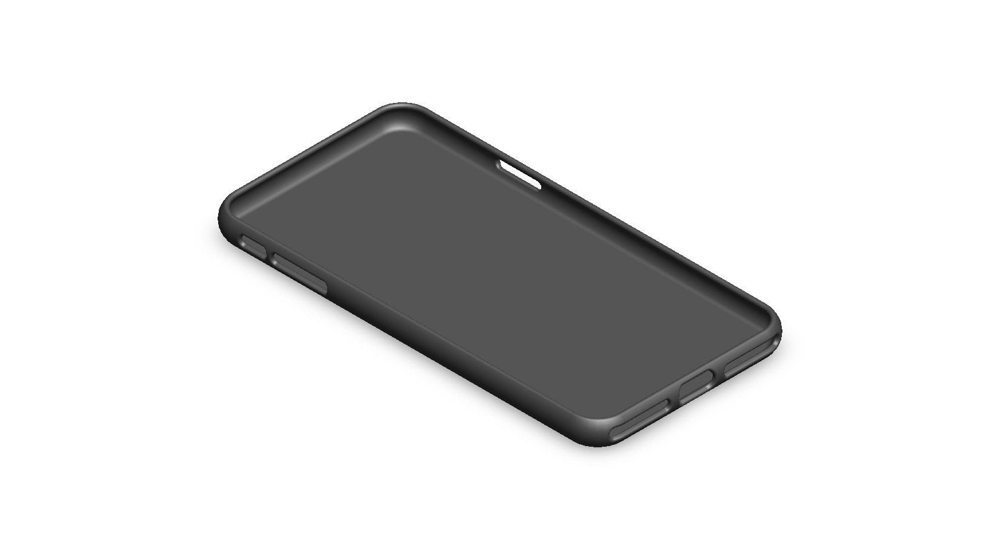
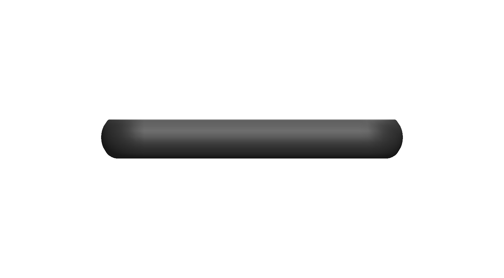
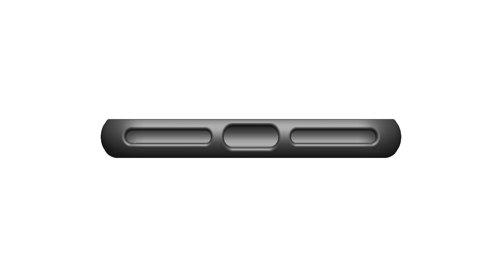
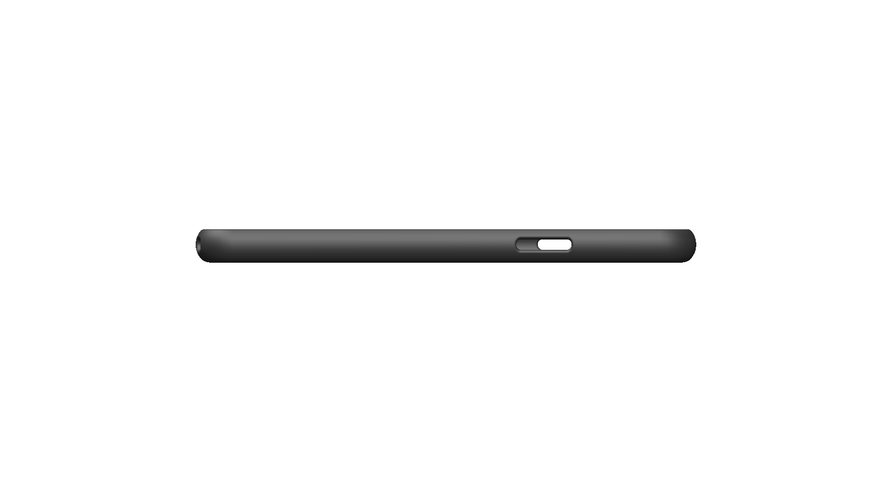
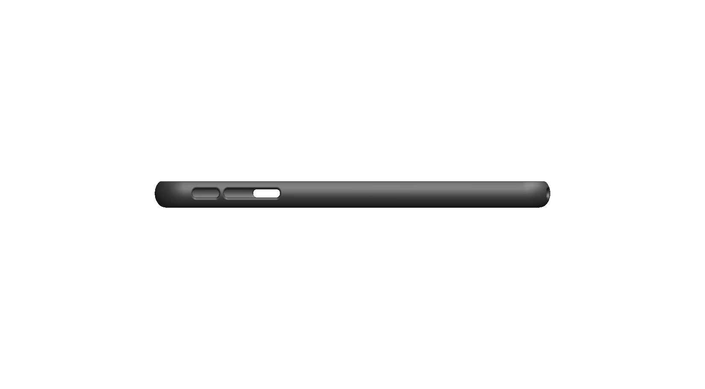
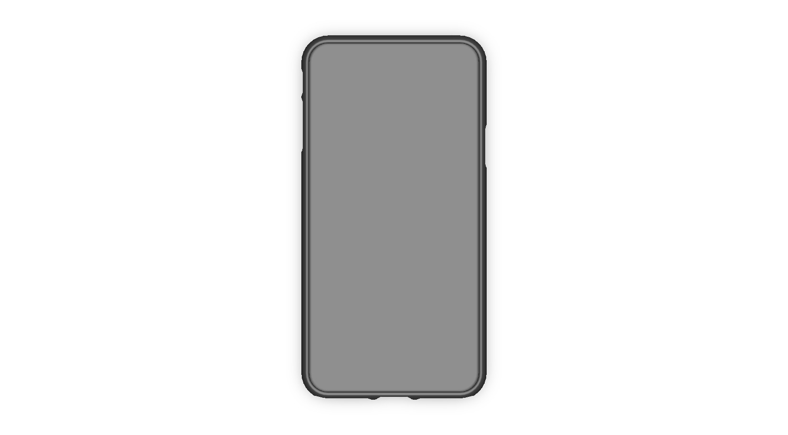
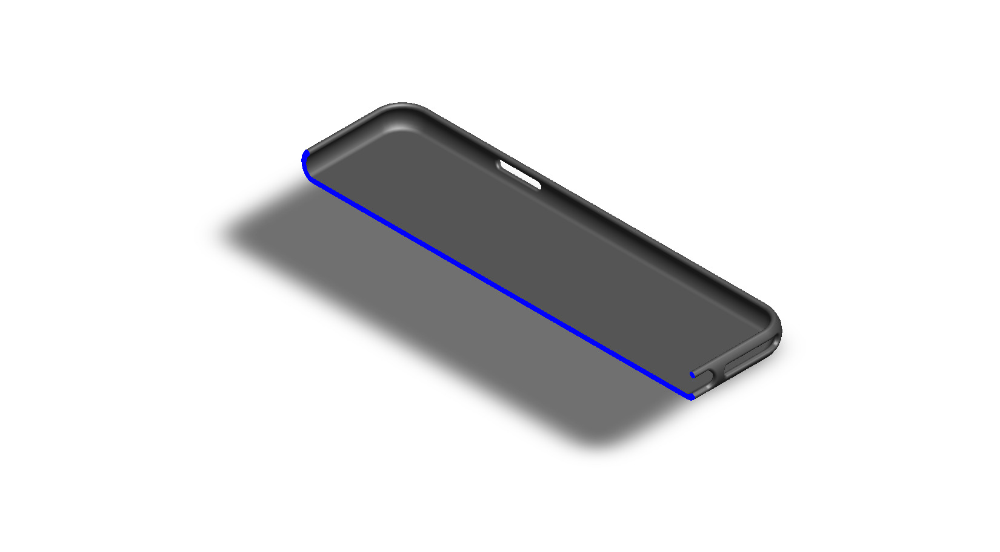
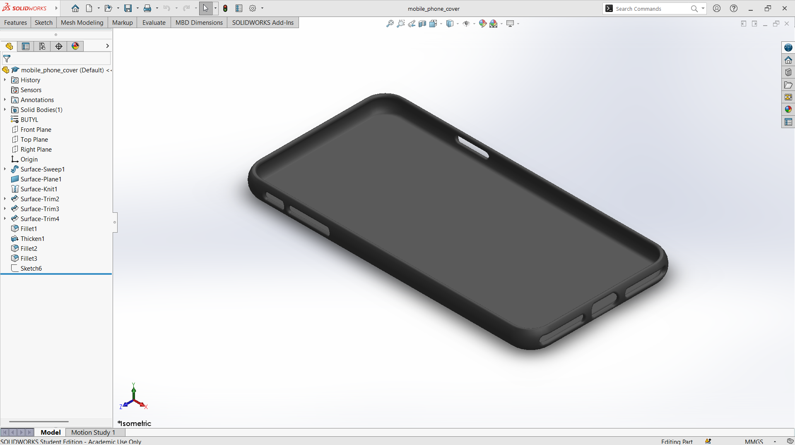

# A Commercial-Inspired Protective Cover for a Mobile Phone

## Summary

A mobile phone is carried everywhere and is exposed to drops, scratches, and daily wear, which is why most people use a cover on it. Seeing the wide variety of covers made for phones and for the iPad inspired me to understand how such a product is designed. I tried to mimic the design of commercial covers by modeling a cover around my own mobile, the Samsung Galaxy J6, and I followed the same approach that I used for my iPad Pro M2 cover.

The cover is a slim shell with rounded corners and a raised lip around the edge, which keeps the screen slightly above a flat surface when the phone is placed face down. Cutouts for the side buttons, the bottom port, and the camera area keep the phone fully usable without taking the cover off. The main challenge was to match the smooth curves of the phone body and to position every opening accurately, since a small error can block a button or leave a gap. The cover was developed using a computational tool, SolidWorks, and the views below show the finished shape from every side, along with a section view of the wall. This prototype is a base concept design that can be improved into a manufacturable product in the future.

---

## Computational Design

|   View    |                              Image                              |
| :-------: | :-------------------------------------------------------------: |
| Isometric |  |
|   Left    |            |
|   Right   |          |
|   Back    |            |
|   Front   |          |
|    Top    |              |
|  Bottom   |        |
|  Section  |      |

---

## Software Used

| Purpose |               Name                |
| :-----: | :-------------------------------: |
| Design  | SolidWorks 2024 (Student Version) |

---

## Feature Tree

| No  |     Name      |
| :-: | :-----------: |
| 01  | Surface Sweep |
| 02  | Surface Plane |
| 03  | Surface Knit  |
| 04  | Surface Trim  |
| 05  |    Fillet     |
| 06  |    Thicken    |
| 07  |    Sketch     |

---

## Feature Tree Image

---

## Applications [^1]

- Scratch and Drop Protection
- Improved Grip
- Built-In Card Wallet
- Kickstand for Hands-Free Viewing
- Raised Edges and Camera Ring for Face-Down Protection

---

## Design Limitations

The design of the mobile phone cover was developed as a prototype product. That’s why the real-life design considerations, including exact device dimensions, material selection, drop-test validation, wireless charging compatibility, usability, proper design specification, monetization, and feasibility, have not been included.

---

## Future Improvements

The cover was designed for one phone model. Button, port, speaker, and camera cutouts should be checked against the manufacturer's dimensions and made parametric for other models. Shock-absorbing corners, a raised camera ring, and a kickstand or card slot are practical additions. Material selection (TPU, polycarbonate, or a hybrid), a drop-test simulation, and a check for interference with wireless charging should also be done before the cover is manufactured.

---

## References

[^1]: [Best iPhone Case Stand Guide](https://smartish.com/blogs/news/best-iphone-case-stand-guide)
